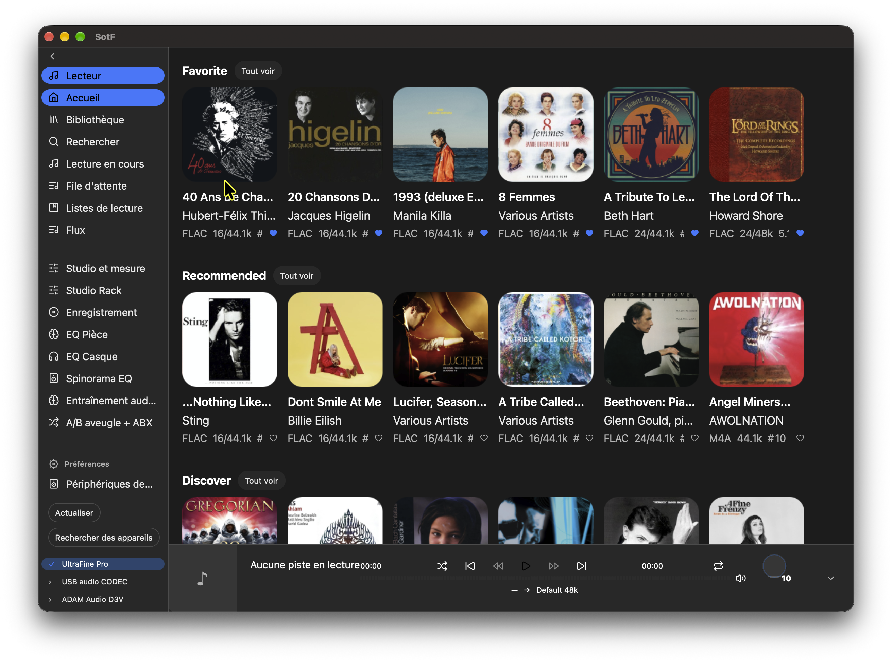
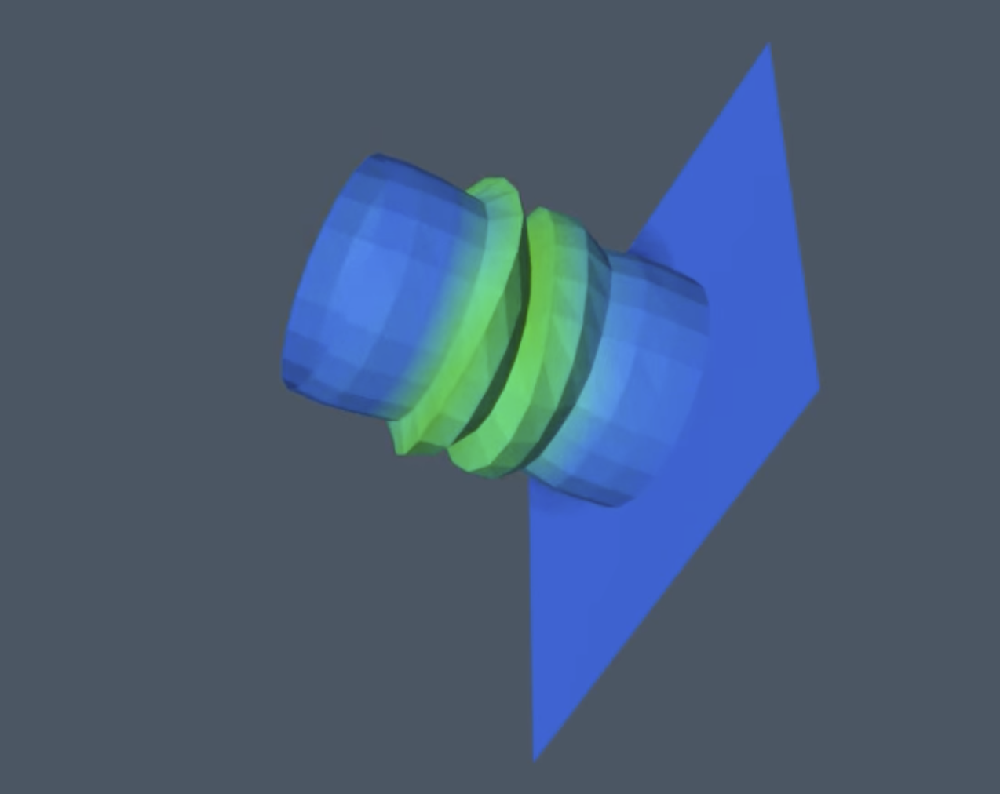
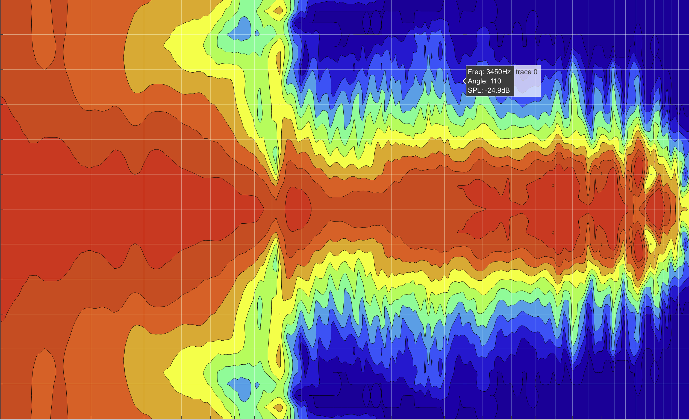

# Engineering from *first principles.*

I build tools to understand sound, create native interfaces, and simulate the physical world.

## Four open source projects: the common thread

### Understand it. Build it. Share it.

From loudspeaker measurements to physical simulation, these projects explore the space between mathematical models and practical tools. Native interfaces make the results accessible. Open source makes the work available to inspect, question, and extend.

 
 

<table>
  <tr>
    <td align="center">
       
      <b>SotF</b>: Audio Swiss Army Knife  
      Better sound, from playback to room correction. An audio player,
      measurement tools, automatic EQ, and a flexible collection of audio
      plugins. 
      <a href="https://sotf.spinorama.org">Discover SotF ↗</a> · 
      <a href="https://github.com/pierreaubert/sotf">Source ↗</a> · 
      <a href="https://github.com/pierreaubert/sotf/issues">Contribute ↗</a>
    </td>
    <td align="center"> 
      <b>GPUI-toolkit</b>: Build Native interfaces in Rust or Python 
      A toolkit for expressive native applications. Reusable UI components, design tokens, charting primitives, and tooling 
      <a href="https://gpui-toolkit.spinorama.org/">Try the live demos ↗</a> · 
      <a href="https://github.com/pierreaubert/gpui-toolkit">Source ↗</a> · 
      <a href="https://github.com/pierreaubert/gpui-toolkit/blob/main/CONTRIBUTING.md">Contribute ↗</a>
    </td>
  </tr>
  <tr>
    <td align="center"> 
      <b>Sonium</b>: Multi-physics and simulation 
      Numerical tools for the physical world. Multi-physics FEM and BEM solvers, mesh generation, and shape and topology optimisation. 
      <a href="https://sonium.spinorama.org">Explore Sonium ↗</a> · 
      <a href="https://github.com/pierreaubert/sonium">Source ↗</a> · 
      <a href="https://github.com/pierreaubert/sonium/issues">Contribute ↗</a>  </td>
    <td align="center"> 
      <b>Spinorama</b>: Speaker Measurements 
      Understand loudspeakers through measurement. Browse, compare, and analyse speaker data to guide your exploration.
       
      <a href="https://www.spinorama.org/">Explore the database ↗</a> · 
      <a href="https://github.com/pierreaubert/spinorama">Source ↗</a> · 
      <a href="https://github.com/pierreaubert/spinorama/issues">Contribute ↗</a>
    </td>
  </tr>
</table>

## Built in the open

### Curiosity is a good starting point.

Try a demo. Read the code. Report an issue or propose an improvement. Pick the project that interests you and join the work on GitHub.

[Find your starting point ↗](https://github.com/pierreaubert)
